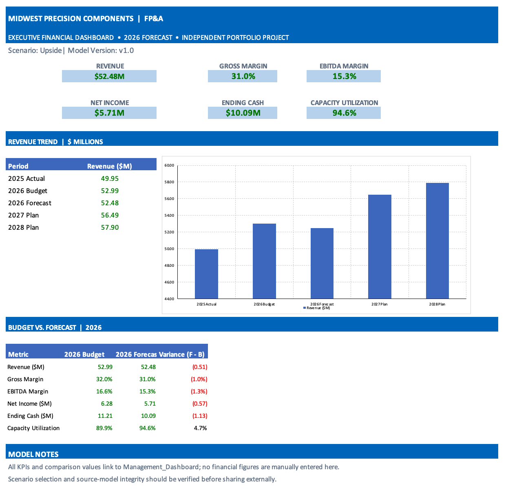
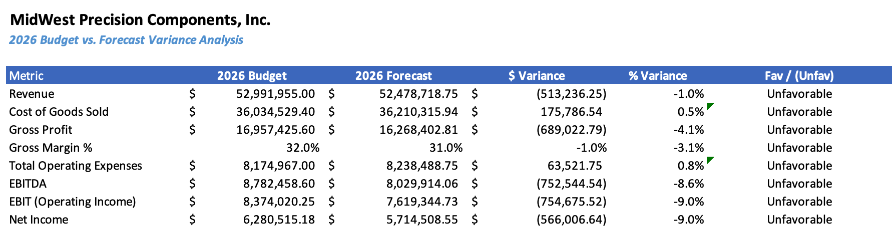
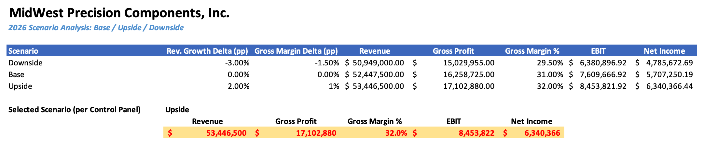

# Manufacturing FP&A | Integrated Financial Model

**Independent Excel portfolio project | Hypothetical manufacturing company**

### Executive Financial Dashboard

An integrated financial planning and analysis model for MidWest Precision Components, Inc. (a hypothetical company), demonstrating driver-based forecasting, operational finance, consolidated financial planning, variance analysis, scenario evaluation, and management reporting.

> **Portfolio disclosure:** This is an independent educational portfolio project using hypothetical data. It does not represent client work or employment at a manufacturing company. All financial results are illustrative.

## Project at a glance

| Illustrative metric | Value |
| --- | ---: |
| 2025 actual revenue (portfolio summary) | $50.0M |
| 2026 forecast revenue | $52.5M |
| 2026 forecast gross margin | 31.0% |
| 2026 forecast EBITDA | $8.0M |
| 2026 forecast EBITDA margin | 15.3% |
| 2026 forecast ending cash | $10.1M |

*Values above are presented in the accompanying portfolio PDF and are illustrative, not independently audited.*

## What the model covers

- **Revenue and demand:** product-level sales volume, pricing assumptions, and revenue projections.
- **Operations and cost:** production, yield, sourcing, foreign exchange, direct labor, manufacturing overhead, and headcount.
- **Financial planning:** integrated P&L, working capital, cash flow, capital expenditures, and depreciation.
- **Decision support:** budget-to-forecast comparisons, variance drivers, base/upside/downside scenarios, and management KPIs.
- **Model controls:** assumptions, scenario selection, and integrity-check worksheets.

## Model architecture

`Assumptions → Revenue & Operating Schedules → P&L / Working Capital / Cash Flow → Variance & Scenario Analysis → Management Dashboard & Checks`

The workbook contains 24 worksheets, including `Cover`, `Dashboard`, `Historical_Actuals`, `FX_Assumptions`, `Control Panel`, `Assumptions`, `Revenue_Model`, `Production_Model`, `Sourcing_Model`, `Direct_Labor`, `Manufacturing_OH`, `Headcount`, `OpEx`, `CapEx`, `Working_Capital`, `P&L`, `Cash_Flow`, `Budget_vs_Actual`, `Forecast`, `Scenario_Analysis`, `Variance_Drivers`, `Management_Dashboard`, `Executive_Dashboard` and `Checks`.

## Files

- **Excel model:** `MidWest_Precision_FP&A_Model.xlsx` — interactive workbook with linked financial schedules.
- **Portfolio overview:** `Manasi_Gawade_FP&A_Portfolio.pdf` — two-page overview of the model and illustrative outputs.

## How to explore

1. Download the `.xlsx` file and open it in Microsoft Excel (desktop recommended).
2. Start with the `Cover` and `Control Panel` sheets.
3. Review assumptions and linked operating schedules.
4. Explore the `P&L`, `Cash_Flow`, `Budget_vs_Actual`, `Scenario_Analysis`, and `Management_Dashboard` sheets.
5. Check the `Checks` worksheet for model integrity tests.

**Note:** Excel calculations and dashboard features may not display fully in GitHub's file preview. Download the workbook to explore it. The uploaded workbook contains an external workbook link; review and resolve it in Excel, recalculate formulas, and verify the `Checks` worksheet before relying on or sharing the results.

## Skills demonstrated

Financial modeling · Budgeting and forecasting · Driver-based planning · Revenue analysis · Manufacturing cost analysis · Working capital · Cash-flow forecasting · Variance analysis · Scenario planning · KPI reporting · Microsoft Excel

## About

Prepared as an independent FP&A portfolio project by Manasi Gawade.

## Financial Dashboards & Analysis

### Budget vs. Actual Analysis

### Scenario Analysis

